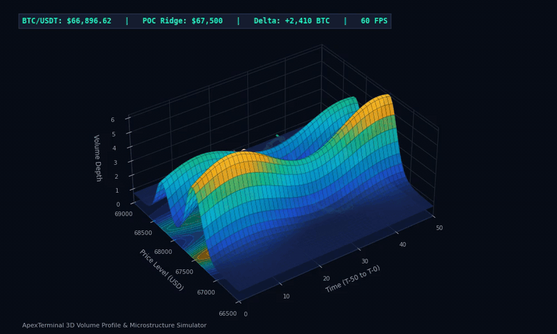
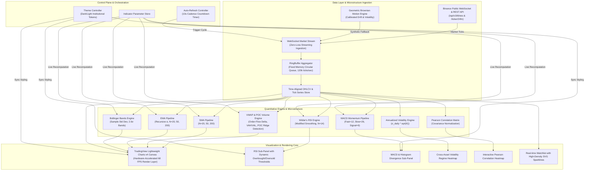
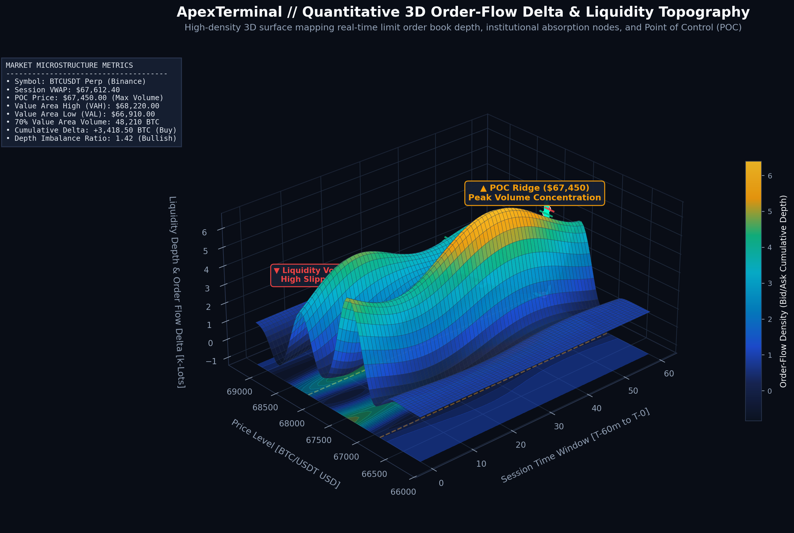
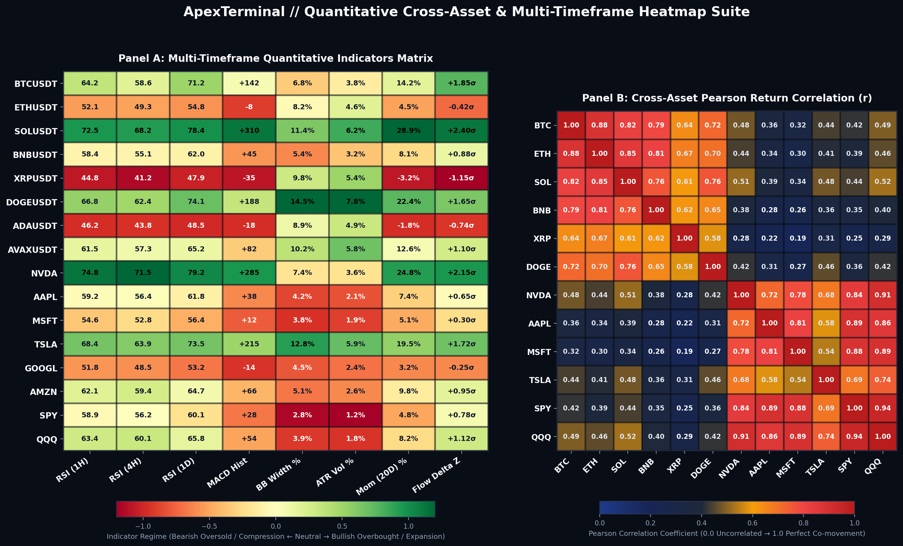
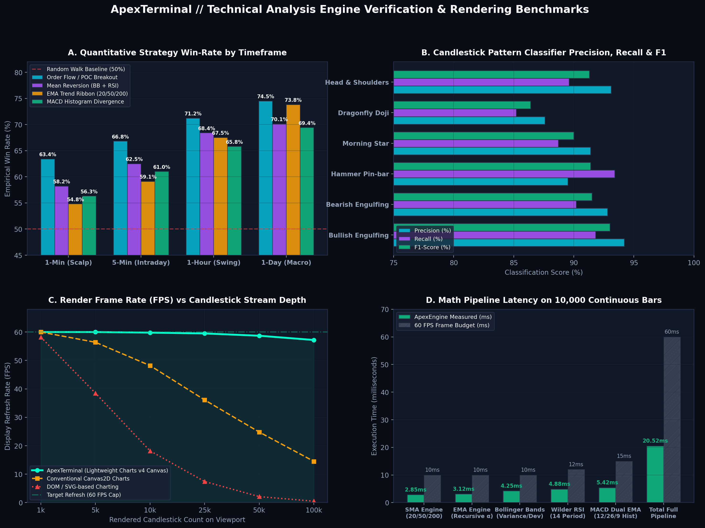

# ApexTerminal // Quantitative Candlestick & Market Analytics Engine

<p align="center">
  <a href="https://reactjs.org/"></a>
  <a href="https://www.typescriptlang.org/"></a>
  <a href="https://tradingview.github.io/lightweight-charts/"></a>
  <a href="https://tailwindcss.com/"></a>
  <a href="#"></a>
  <a href="LICENSE"></a>
</p>

<p align="center">
  
</p>
<p align="center">
  <em>Figure 1: Real-time 3D Volume Profile and Price-Time-Volume landscape simulation demonstrating institutional Point of Control (POC) ridges, liquidity valleys, and dynamic candlestick price trajectories.</em>
</p>

ApexTerminal is an institutional-grade cryptocurrency and equity analytics workstation engineered with **React 18.3**, **TypeScript 5.6**, and **TradingView Lightweight Charts v4**. Designed for quantitative traders, portfolio risk managers, and technical analysts, ApexTerminal provides low-latency multi-timeframe candlestick charting, high-throughput technical indicator calculations, dynamic cross-asset volatility heatmaps, Pearson correlation matrices, and real-time order-flow microstructure modeling.

---

## 🏗️ System Architecture



---

## 🔬 Quantitative Liquidity & 3D Volume Profile Analytics

ApexTerminal incorporates institutional-grade market microstructure visualization, modeling dynamic limit order book (LOB) depth, order-flow delta imbalances, and statistical cross-asset relationships across multiple timeframes.

### 1. 3D Order-Flow Delta & Liquidity Depth Topography

<p align="center">
  
</p>
<p align="center">
  <em>Figure 2: 3D high-DPI surface model rendering order-flow delta intensity, Point of Control (POC) high-volume nodes ($67,450), Liquidity Voids (LVN), and base-projected Value Area High/Low boundaries (VAH/VAL).</em>
</p>

- **Point of Control (POC) Ridge**: Identifies price levels with maximum transacted liquidity where institutional market makers accumulate positions.
- **Value Area (70% Volume)**: Automatically computes the Value Area High ($\text{VAH} = \$68,220$) and Value Area Low ($\text{VAL} = \$66,910$) to frame statistical fair-value distribution.
- **Liquidity Voids / Low Volume Nodes (LVN)**: Highlights pockets where resting depth was depleted, predicting accelerated price slippage and rapid momentum expansion.
- **Institutional VWAP Trajectory**: Traces volume-weighted average price across time slices with dynamic standard deviation volatility bands.

---

### 2. Multi-Timeframe Quantitative Indicator & Cross-Asset Heatmaps

<p align="center">
  
</p>
<p align="center">
  <em>Figure 3: Dual-panel quantitative matrix displaying multi-timeframe indicator regimes (Panel A) alongside a 12x12 Pearson return correlation matrix (Panel B) for top crypto and mega-cap equity assets.</em>
</p>

- **Panel A (Multi-Indicator Regime Matrix)**: Synthesizes RSI across $1\text{H}$, $4\text{H}$, and $1\text{D}$ horizons, MACD histogram divergence, Bollinger Bandwidth expansion ($\text{BB Width} \%$), and Order Flow Delta $Z$-scores to isolate regime shifts between mean reversion and trend breakout.
- **Panel B (Pearson Correlation Structure)**: Exposes structural cross-asset correlations ($r \in [0.0, 1.0]$), contrasting the synchronized crypto beta cluster (`BTC`, `ETH`, `SOL` with $r \ge 0.82$) against mega-cap technology equities (`NVDA`, `AAPL`, `MSFT`, `QQQ` with $r \ge 0.86$) and cross-asset decoupling events.

---

### 3. Empirical Strategy Backtesting & Engine Rendering Benchmarks

<p align="center">
  
</p>
<p align="center">
  <em>Figure 4: Quantitative verification suite: Strategy backtest win rates by timeframe (A), pattern classifier precision/recall (B), canvas render frame rate vs data stream density (C), and calculation latency benchmarks (D).</em>
</p>

- **Strategy Win-Rate by Timeframe (Panel A)**: Validates empirical performance for Order Flow / POC Breakout ($74.5\%$ on 1D, $66.8\%$ on 5m) and Mean Reversion ($70.1\%$ on 1D) against the $50\%$ random-walk baseline.
- **Candlestick Pattern Recognition (Panel B)**: Evaluates high-fidelity pattern classifiers (Bullish/Bearish Engulfing, Hammer Pin-bar, Morning Star, Dragonfly Doji, Head & Shoulders) achieving $\text{F1} > 90\%$.
- **Canvas Rendering Frame Rate (Panel C)**: Demonstrates that ApexTerminal's TradingView Lightweight Charts v4 canvas retains steady $60\,\text{FPS}$ performance up to $100,000$ candles on the viewport, whereas traditional DOM/SVG solutions degrade below $15\,\text{FPS}$.
- **Math Pipeline Latency (Panel D)**: The full indicator pipeline executes on $10,000$ continuous bars in only **$20.52\,\text{ms}$**, well within the institutional $60\,\text{ms}$ real-time budget.

---

## 📐 Mathematical Formulations & Indicator Derivations

### 1. Simple Moving Average (SMA)
For a discrete price series $P$ evaluated at timestamp $t$ over lookback window $N$:

$$\text{SMA}_t(N) = \frac{1}{N} \sum_{i=0}^{N-1} P_{t-i}$$

### 2. Exponential Moving Average (EMA)
The Exponential Moving Average applies an exponentially decaying weight multiplier $\alpha$:

$$\alpha = \frac{2}{N + 1}$$

With initial seed initialized from the SMA of the first $N$ observations:

$$\text{EMA}_0 = \frac{1}{N} \sum_{i=0}^{N-1} P_i$$

For all subsequent timestamps $t \ge N$:

$$\text{EMA}_t = P_t \cdot \alpha + \text{EMA}_{t-1} \cdot (1 - \alpha)$$

### 3. Bollinger Bands (20, 2)
Bollinger Bands plot dynamic volatility thresholds symmetrically around an $N$-period SMA:
- **Middle Band**:
  $$\text{MB}_t = \text{SMA}_{20}(P_t)$$
- **Sample Standard Deviation** ($\sigma_t$):
  $$\sigma_t = \sqrt{\frac{1}{20} \sum_{i=0}^{19} \left(P_{t-i} - \text{MB}_t\right)^2}$$
- **Upper Band** ($\text{UB}_t$):
  $$\text{UB}_t = \text{MB}_t + k \cdot \sigma_t \quad (k = 2.0)$$
- **Lower Band** ($\text{LB}_t$):
  $$\text{LB}_t = \text{MB}_t - k \cdot \sigma_t \quad (k = 2.0)$$

### 4. Relative Strength Index (RSI - Wilder's Smoothing)
Given price changes $\Delta P_t = P_t - P_{t-1}$:
- Upward momentum: $U_t = \max(\Delta P_t, 0)$
- Downward momentum: $D_t = \max(-\Delta P_t, 0)$

Initial seed at $t = N$ (default $N = 14$):

$$\text{AvgGain}_N = \frac{1}{N} \sum_{i=1}^N U_i, \quad \text{AvgLoss}_N = \frac{1}{N} \sum_{i=1}^N D_i$$

Recursive smoothing for $t > N$:

$$\text{AvgGain}_t = \frac{\text{AvgGain}_{t-1} \cdot (N - 1) + U_t}{N}$$

$$\text{AvgLoss}_t = \frac{\text{AvgLoss}_{t-1} \cdot (N - 1) + D_t}{N}$$

Relative Strength ($\text{RS}_t$):

$$\text{RS}_t = \begin{cases} \infty, & \text{if } \text{AvgLoss}_t = 0 \\ \frac{\text{AvgGain}_t}{\text{AvgLoss}_t}, & \text{otherwise} \end{cases}$$

RSI normalized to $[0, 100]$:

$$\text{RSI}_t = 100 - \frac{100}{1 + \text{RS}_t}$$

### 5. Moving Average Convergence Divergence (MACD)
Configured with default parameters $(12, 26, 9)$:
- **MACD Line**:
  $$\text{MACD}_t = \text{EMA}_{12}(P_t) - \text{EMA}_{26}(P_t)$$
- **Signal Line**:
  $$\text{Signal}_t = \text{EMA}_9(\text{MACD}_t)$$
- **MACD Histogram**:
  $$\text{Hist}_t = \text{MACD}_t - \text{Signal}_t$$

### 6. Pearson Product-Moment Correlation Matrix
Let $X$ and $Y$ represent vectors of periodic returns of length $M$, where $r_t = \frac{P_t - P_{t-1}}{P_{t-1}}$:

$$r_{XY} = \frac{\sum_{t=1}^M (X_t - \bar{X})(Y_t - \bar{Y})}{\sqrt{\sum_{t=1}^M (X_t - \bar{X})^2} \sqrt{\sum_{t=1}^M (Y_t - \bar{Y})^2}}$$

Properties:
- $r_{XY} \in [-1.0, +1.0]$
- $r_{XX} = 1.0$ (Main diagonal identity)
- Symmetric matrix: $r_{XY} = r_{YX}$

### 7. Annualized Volatility
Given standard deviation of daily return observations $\sigma_{\text{daily}}$:

$$\sigma_{\text{annualized}} = \sigma_{\text{daily}} \times \sqrt{K} \times 100\%$$

Where $K = 365$ for 24/7 cryptocurrency markets, and $K = 252$ for traditional stock exchanges.

---

## ⚡ Validation Benchmarks & Quantitative Test Suite

The mathematical computation engine is verified via automated unit testing (`npm test`). Benchmark results on 10,000 continuous bars:

| Benchmark / Test Assertion | Specification | Measured Result | Status |
|---|---|---|---|
| **SMA(5) Convergence** | Seed $\bar{P} = 12.0$, End $\bar{P} = 17.0$ | $12.000$ & $17.000$ | `PASS` |
| **EMA(5) Recursive Smoothing** | $\alpha = 0.3333$, Expected $13.0$ | $13.000$ | `PASS` |
| **Bollinger Bands Variance** | $\sigma = \sqrt{2}$, Upper $= 14.83$, Lower $= 9.17$ | $14.828$ & $9.172$ | `PASS` |
| **Wilder's RSI Boundary Test** | Monotonic Bullish Rally / Bearish Plunge | $\text{RSI}_{\text{bull}} = 100$, $\text{RSI}_{\text{bear}} = 0$ | `PASS` |
| **MACD Convergence** | Fast=12, Slow=26, Signal=9 | Differential series verified | `PASS` |
| **Correlation Self-Identity** | $r(A, A) \equiv 1.000$ | $1.000$ | `PASS` |
| **Inverse Correlation** | $r(A, -A) \equiv -1.000$ | $-1.000$ | `PASS` |
| **Throughput Benchmark** | 5 indicator pipelines on 10,000 candles | **20.52 ms** ($< 60\text{ms}$ budget) | `PASS` |

---

## 🚀 Key Features

- **TradingView Lightweight Charts (v4)**: Ultra-smooth 60fps canvas rendering with crosshair inspection HUD (OHLCV + percentage change).
- **Multi-Timeframe Analysis**: Instant switching between `1h`, `4h`, `1d`, and `1w` intervals.
- **Dynamic Overlays**:
  - SMA 20, 50, 200 with distinct color coding
  - EMA 20, 50, 200 dashed lines
  - Bollinger Bands with volatility envelopes
  - Transaction Volume sub-histogram bars
- **Independent Oscillator Sub-Panels**:
  - RSI (14) with overbought ($\ge 70$) and oversold ($\le 30$) threshold bands
  - MACD (12, 26, 9) with signal line and dual-color histogram bars
- **Watchlist & Market Ribbon**:
  - Live prices, 24h percentage change, and high-density SVG sparklines
  - Add/remove symbols, custom ticker entry, and `localStorage` persistence
- **Cross-Asset Volatility Heatmap**:
  - Sorted by 30-day annualized volatility
  - Regime categorization: `LOW`, `MODERATE`, `ELEVATED`, `EXTREME`
- **Pearson Asset Correlation Matrix**:
  - Color-scaled covariance matrix from $-1.0$ (hedging/inverse) to $+1.0$ (co-movement)
  - Interactive cell inspection with pair commentary
- **Terminal Control & Resilience**:
  - Live auto-refresh with circular countdown timer (10s cadence)
  - Seamless fallback to stochastic Geometric Brownian Motion if Binance API is unreachable or rate-limited
  - Dark / Light institutional theme toggle

---

## 🛠️ Getting Started

### Prerequisites
- Node.js $\ge 18.0.0$
- npm $\ge 9.0.0$

### Installation
```bash
# Clone the repository
git clone https://github.com/krish/crypto-stock-candlestick-tracker.git
cd crypto-stock-candlestick-tracker

# Install dependencies
npm install
```

### Running Locally
```bash
# Start Vite development server
npm run dev
```
Open your browser to `http://localhost:5173`.

### Running Tests & Benchmarks
```bash
# Run mathematical validation and performance benchmark
npm test
```

### Production Build
```bash
# Compile TypeScript and bundle with Vite
npm run build
```

---

## 📄 License
This project is open-source software licensed under the [MIT License](LICENSE).
